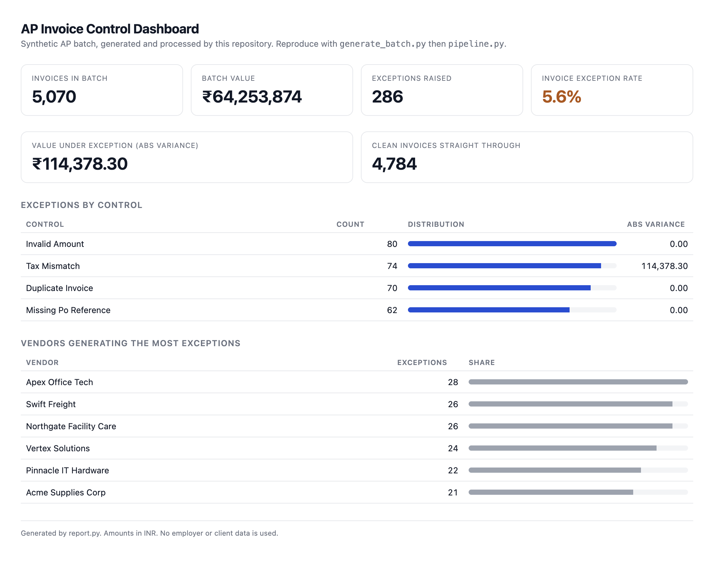

# AP Invoice Exception & Reconciliation Pipeline

Turns messy invoice documents into validated records, applies four financial controls, and
routes exceptions to a review queue with an audit trail. Built for the manual exception-spotting
step in a high-volume Accounts Payable operation, where a mis-keyed GST rate or a re-submitted
vendor invoice is currently caught only because someone happens to notice it.




**Zero dependencies.** Python 3.8+ standard library only, no `pip install`. 13 unit tests.
CI runs on Python 3.10 to 3.13 on every push.

## Where this came from

The workflow is modelled on the exception handling I did at Jones Lang LaSalle: high-volume
invoice batches uploaded through Capturis, records reconciled between Corrigo work orders and
Oracle E1, landlord statements checked line by line, and aging items tracked in spreadsheets.
The recurring failures there were consistent and mechanical: tax rates applied at the wrong
percentage, the same invoice arriving twice from the same vendor, invoices without a PO
attached, and zero-value rows that had to be corrected before posting.

This repository makes those four failures machine-checkable. It uses synthetic data only. No
employer or client data appears anywhere in the repo.

## Pipeline

```
raw invoice documents (txt/PDF-derived text)
        |
        |  intake.py       deterministic field extraction, OCR noise tolerated
        v
structured batch (invoice_id, vendor, date, PO, total, tax)
        |
        |  pipeline.py     controls C1-C4, additive exception routing
        v
invoices_processed.csv      every row, with a reconciliation status
exceptions_flagged.csv      one row per exception: type, variance, required action
run_summary.txt             audit summary by control
        |
        |  report.py       self-contained HTML dashboard
        v
docs/dashboard.html
```

## Quick start

```bash
git clone https://github.com/maitykunal2004/ai-finance-invoice-automation.git
cd ai-finance-invoice-automation

python3 intake.py                 # 8 documents -> 7 records, 1 sent to manual review
python3 pipeline.py               # 12 rows -> 7 matched, 5 exceptions
python3 report.py --out docs/dashboard.html
python3 -m unittest discover -s . -p "test_*.py" -v
```

## Controls

| ID | Control | Rule | Route |
|----|---------|------|-------|
| C1 | Tax mismatch | `tax_amount` must equal `invoice_total x 5%` within a ₹1 rounding tolerance | `EXCEPTION_TAX_MISMATCH` |
| C2 | Duplicate invoice | Same vendor + amount + PO appearing more than once. The first occurrence is payable; later occurrences are held | `EXCEPTION_DUPLICATE_INVOICE` |
| C3 | Missing PO reference | Non-PO invoices are held for PO attachment instead of being silently posted | `EXCEPTION_MISSING_PO_REFERENCE` |
| C4 | Invalid amount | `invoice_total` must be greater than zero and parseable | `EXCEPTION_INVALID_AMOUNT` |

When several controls fire on one invoice, **every** reason is written to the exception log and
the status column shows the highest-priority one, so one row cannot hide a second problem.

## Intake accuracy

`samples/inbox` holds eight invoice documents written in the shapes OCR actually produces:
`Rs. 13,125.00`, `GST @5%   625.00`, `03/11/2026`, `4 Nov 2026`, `2026-11-05`, a missing PO,
a `Tax Invoice  NA-778812`, and one scan that OCR destroyed.

| Result | Value |
|--------|-------|
| Documents read | 8 |
| Structured records produced | 7 |
| Sent to manual review | 1 (unreadable scan) |
| Field-level accuracy on parsed documents | asserted field by field in `test_intake.py` |

Two failure modes are covered by tests because they are the ones that cause silent bad data:

- **A GST rate read as a tax amount.** `GST @5%   625.00` must yield 625.00, never 5.00.
- **An invented PO number.** Text like `(no purchase order raised)` must leave the PO blank, so
  control C3 catches it, rather than being scraped into a fake `PO` value.

The LLM path is optional and degrades loudly. `--llm` sends text to an OpenAI-compatible
endpoint when `OPENAI_API_KEY` is set; any document whose response is missing required fields
falls back to the deterministic parser, and the run report states how many documents each path
handled. A model failure is never mistaken for a clean extraction.

## Scale and accuracy

`generate_batch.py` makes a seeded synthetic batch with a known defect rate, so the controls can
be scored against ground truth instead of inspected by eye.

```
python3 benchmark.py --rows 50000
```

Committed result (`docs/scale_test.txt`):

| Metric | Value |
|--------|-------|
| Rows in batch | 50,748 |
| Runtime | 0.20 s (252,431 rows/s) |
| Planted defects | 3,012 |
| Exceptions raised | 3,012 |
| Recall on planted defects | 100.0% |
| Precision | 100.0% |
| Clean invoices straight through | 47,736 |

A 200,000-row batch runs in 0.76 s. Duplicates are keyed batch-wide, so cost stays linear in
rows rather than quadratic in pairs.

## Files

| File | Purpose |
|------|---------|
| `intake.py` | Document to structured records, deterministic by default, optional LLM adapter |
| `pipeline.py` | Controls C1-C4, exception routing, audit summary |
| `report.py` | Self-contained HTML dashboard from pipeline output |
| `generate_batch.py` | Seeded synthetic batch generator with planted defects |
| `benchmark.py` | Runtime plus recall and precision against ground truth |
| `test_intake.py`, `test_pipeline.py` | 13 unit tests, run in CI on Python 3.10 to 3.13 |
| `schema.sql` | PostgreSQL schema plus `v_invoice_control_failures`, `v_three_way_match`, `v_exception_summary` |
| `invoices_raw.csv` | 12-row demo batch |
| `invoices_processed.csv`, `exceptions_flagged.csv`, `run_summary.txt` | Committed output of `python3 pipeline.py`, reproducible on re-run |
| `samples/inbox/` | Eight OCR-shaped invoice documents used by the intake tests |

## Design notes

- **Money is `Decimal`, never `float`.** A rounding error in a tax comparison is the difference
  between a clean batch and a queue full of false exceptions.
- **Duplicates are batch-wide, not row-by-row.** A duplicate only exists relative to the batch,
  so keys are counted up front and then matched off occurrence by occurrence.
- **Tolerance is explicit and small.** ₹1 of rounding is not a control failure; ₹150 is.
- **Unparseable documents go to a person.** A blank field that trips a control is better than a
  confident guess that posts.
- **Reproducibility is tested, not claimed.** CI re-runs the pipeline and diffs the output
  against the committed CSV.

## Scope

Built and tested here: document intake with measured accuracy, controls C1-C4, exception queue,
audit summary, scale benchmark with recall and precision, database schema and views, HTML
dashboard, CI across five Python versions.

Not here: a live database (the schema is not wired to a running Postgres), native PDF rasterisation
and OCR (input is text, so a PDF pipeline such as `pdftotext` sits outside this repo), per-client
configuration for tax rates (5% is hard-coded as a constant, not per-vendor), and scheduling.

## Data

`invoices_raw.csv`, `samples/inbox`, and every generated batch are synthetic. Vendor names,
amounts, and PO numbers are fabricated. No employer or client data is used.

## License

MIT. See `LICENSE`.
